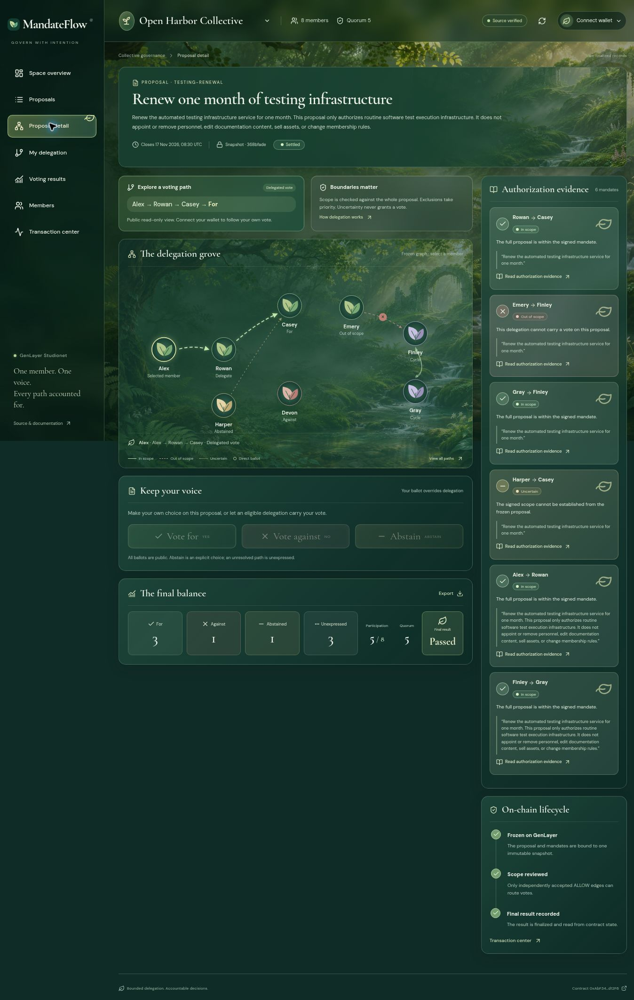

# MandateFlow

**Govern together. Delegate with intention.**

A scope-bound delegation application for small member collectives on GenLayer. Members sign an allowed scope, explicit exclusions and a redelegation limit. Independent validator reasoning determines whether the entire frozen proposal fits each mandate. Deterministic contract code then routes every original vote, handles direct overrides and cycles, and accounts for each member exactly once.

[Open the application](https://halihalibt.github.io/mandateflow-genlayer/) · [Contract](https://explorer-studio.genlayer.com/address/0xAbF34de3273BDbF463Ea8d5b944D746394bd12F6)

**Deployed and verified on Stable Studionet.** The eight-member full-consensus lifecycle is SETTLED: 3 YES, 1 NO, 1 ABSTAIN and 3 UNEXPRESSED, with quorum 5 and PASSED. Independent verification re-fetches all 38 primary/adversarial transactions, compares deployed source byte-for-byte, checks calldata and validates the final snapshot and counts. The observed scope decisions include ALLOW, DENY and UNCERTAIN; these are real contract records, not seeded frontend data.

To review without a wallet, open the application → Proposal detail → Voting results. Select a member to follow their original vote, or open an authorization edge to inspect its frozen scope and quotation anchors. The default example is synthetic governance content with real signatures, consensus, writes and finalized readbacks.



## The problem

Delegating routine maintenance decisions should not authorize an unrelated personnel decision hidden in the same proposal. A delegate should not be able to reassign a vote indefinitely. An organizer should not be able to edit the proposal after members delegated or count a delegation cycle as support.

MandateFlow binds the full proposal, electorate, mandates and rules to one snapshot. A matching title is insufficient. Explicit exclusions take priority and uncertain scope grants no authority.

## Workflow

1. Create a collective and invite wallets. Each invited wallet accepts membership itself.
2. Sign a default delegation: one member, 1–4 allowed/excluded clauses in total, and 1–8 hops. Updates affect future snapshots only.
3. Freeze a proposal with its complete text, membership, mandate graph, quorum count and 1–72-hour voting duration.
4. Review scopes in batches of up to four through real GenLayer Leader/Validator consensus. ALLOW enables an edge; DENY and UNCERTAIN disable it. Failed execution remains incomplete.
5. Open voting after every edge has a decision. Every frozen member may cast or update a direct YES, NO or ABSTAIN ballot. Direct ballots take priority over default delegation.
6. After the deadline, anyone settles once. The contract stores routes, exact counts, quorum and the decision. No asset transfer or organizational action is executed.

Public proposals, mandate evidence, routes and results are readable without a wallet. The forest-themed English application includes proposal creation, delegation editing, membership management, source verification, EIP-6963 wallet discovery, explicit temporary testnet signers, transaction recovery, readback checks and record export.

## Run

Node.js 22+ and Python 3.12+:

```sh
npm ci
npm test
npm run dev
npm run build
```

The application is a static Vite/React/TypeScript build. GitHub Pages deploys `dist/` through the included workflow. Hash routes support direct links and page reloads. All authority comes from the Intelligent Contract; no private database substitutes for chain state.

## Contract and verification

- Source: [`contracts/mandate_flow.py`](contracts/mandate_flow.py).
- Network: GenLayer Stable Studionet, chain 61999, RPC `https://studio.genlayer.com/api`.
- Pinned JavaScript SDK: `genlayer-js@1.1.8`; Python GenVM dependency is pinned in the source header.
- Address/source digest/deployment transaction: [`public/deployment.json`](public/deployment.json).
- Actual transaction intents, receipts and readbacks: [`evidence/live.json`](evidence/live.json).
- Mixed-motion/prompt-injection and permission checks: [`evidence/adversarial.json`](evidence/adversarial.json).
- Independent source, receipt and final-state check: [`evidence/verification.json`](evidence/verification.json).
- Real browser-signed lifecycle: [`evidence/browser.json`](evidence/browser.json).

```sh
# GenVM interface/schema check, not an onchain business acceptance test
npm run schema
# Deploy and run acceptance in a NEW isolated working directory
npm run live
# Independent read-only verification of the recorded completed flow
npm run verify
# Independent offline route-witness/certificate verification
python3 scripts/verify-proof.py
```

On Node 24 behind an inherited HTTPS proxy, use `NODE_USE_ENV_PROXY=1` for network scripts. Preserve TLS verification and platform CA configuration.

`live.mjs` journals each returned hash before polling and resumes existing operations rather than sending duplicates. It refuses source changes after deployment. It creates independent temporary test accounts, uses the official Studio faucet and sends zero value. Its ignored mode-0600 signer file is solely for resuming the acceptance run and is removed after completion. A completed journal exits without generating replacement accounts or new writes. Never commit signing material or fund temporary accounts with valuable assets.

The minimum voting period is genuinely one hour; the acceptance script does not skip or alter the contract clock. Run it only when intending real testnet writes. `verify.mjs` signs nothing and does not fund accounts.

## Mechanism and boundaries

Each original member contributes one unit. Routing terminates at a signed direct ballot, or records an unexpressed reason: outside scope, uncertain scope, no endpoint, cycle or exhausted hop budget. Direct ABSTAIN is explicit participation. Unexpressed votes do not count toward quorum.

`YES + NO + ABSTAIN + UNEXPRESSED = snapshot member count`.

A proposal passes only when participation reaches its frozen integer quorum and YES exceeds NO. A tie does not pass. The application distinguishes provisional acceptance, finalized execution and matching state readback.

- [Architecture and contract interface](docs/architecture.md)
- [Use and wallet behavior](docs/usage.md)
- [Verification and limitations](docs/verification.md)

All proposals, authorizations and ballots are public. Membership is not proof of unique humans. Consensus assesses declared authorization scope, not a proposal's truth, legality or wisdom. Missing external prerequisites remain uncertain; the application does not claim an exhaustive external fact check. No token, escrow, private voting, automated treasury execution or paid API is required.

## Artwork

The forest backdrop is original AI-generated decorative artwork created for MandateFlow and served locally as WebP. Node marks and interface icons are vector graphics; Lucide icons are covered by their upstream ISC license. The scene is decorative and conveys no contract data. MIT applies to this project.
